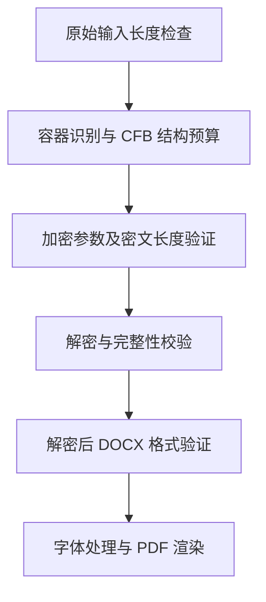
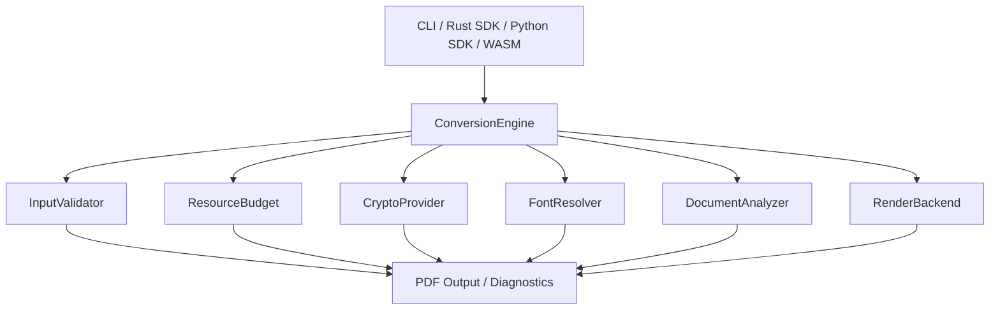

# WorDF 第二轮代码审查与优化建议

> 审查日期：2026-11-24  
> 项目：[vusiif/WorDF](https://github.com/vusiif/WorDF)  
> 审查分支：`windows-sync`  
> Cargo 版本：`1.0.0`（含 Unreleased 更新）  
> 审查方式：静态源码审查、变更日志检查、与上一轮审查对比。

## 0. 执行摘要

与上一版本相比，WorDF 已经从基础格式转换工具逐渐发展为功能较完整的独立文档转换引擎。上一轮提出的跨平台提交、批量转换、输入限制及报告等问题已得到不同程度处理，并增加了文档分析、严格模式、页面范围、加密文档处理、多级字体回退等能力。

现阶段建议优先保证数据安全、依赖安全、加密完整性、转换正确性和增量转换可靠性，再进行性能优化及功能扩展。建议下一版本定位为 **v1.1.0 稳定性与正确性版本**（建议版本号，非项目已发布版本）。

**审查限制：** 本文整理自本次会话第二轮静态审查结果，未重新拉取仓库或执行编译、测试、性能基准、Fuzz 或漏洞复现。GitHub 首页与部分源码可能存在不同时间的缓存，审查未锁定 commit SHA。以下源码链接指向可变分支，行号可能随更新变化。风险和优先级为静态推断，实际影响需要回归测试确认。

优先级定义：P0 为优先处理的数据安全或资源防护问题；P1 为重要正确性、安全与兼容性问题；P2 为性能、工程质量及边界问题；P3 为后续功能扩展。

## 1. 上一轮审查的问题修复情况

| 上一轮问题 | 当前状态 |
|---|---|
| macOS 原子提交编译问题 | 源码已修复 |
| 批量同名文件冲突 | 变更日志显示已处理，仍有边界问题 |
| 批量与单文件安全校验不一致 | 变更日志显示已修复部分路径，仍有遗漏 |
| 输入文件读取前缺少资源限制 | 已增加有界读取 |
| 批量 JSON 报告缺失 | 已实现 |
| 批量退出码不一致 | 已修正 |
| 纯内存 API 描述不准确 | README 已修正 |
| 多级字体回退 | 已引入，尚需贯通渲染 |
| 跨平台 CI | 已添加 |
| DOCX 重复压缩 | 已有 raw-copy 和 Cow 优化，仍有改进空间 |
| XML 命名空间处理 | 仍需检查各解析路径 |
| 全局内存预算及转换超时 | 尚未见公开配置 |

已新增的 CLI 能力包括 `--analyze`、`--strict`、`--recursive`、`--resume`、`--pages`、`--password`、PDF 元数据设置及标准流支持。

参考：[CHANGELOG.md](https://github.com/vusiif/WorDF/blob/windows-sync/CHANGELOG.md)、[README.md](https://github.com/vusiif/WorDF/blob/windows-sync/README.md)。

## 2. 新版仍然存在的问题

### 2.1 [P0] 批量 JSON 报告可能覆盖输入文档或输出 PDF

**位置：** [src/cli/batch/mod.rs:62–123](https://github.com/vusiif/WorDF/blob/windows-sync/src/cli/batch/mod.rs#L62-L123)

批量模式单独验证 JSON 报告路径，并检查 PDF 目标是否重名，但未见将报告路径、所有输入文档和所有 PDF 目标进行统一实体冲突检查。允许覆盖时，报告若与源文档或 PDF 目标相同，可能造成数据丢失。

**建议：** 在工作线程启动前创建 `BatchPlan`，统一验证输入、PDF、报告路径及文件身份，考虑符号链接、硬链接、大小写等价及文件系统竞态。拒绝冲突后不得产生任何输出副作用。

**验收：** 报告与任何输入或 PDF 目标冲突时，转换开始前失败；原始文件和已有输出保持不变。

### 2.2 [P0] 加密处理发生在核心输入限制之前

**位置：** [src/lib.rs:151–167](https://github.com/vusiif/WorDF/blob/windows-sync/src/lib.rs#L151-L167)

当前先调用 `decrypt_office_document()`，再调用 `verify_and_detect_format()`。原始输入大小限制和 CFB 结构验证因此不能完整保护解密阶段。

现有防护包括最大密码哈希迭代次数 1,000,000、EncryptionInfo 长度限制、加密数据读取限制和解密后大小限制。但仍应在解析和解密之前检查原始容器，并正确传播读取错误。

推荐流程：



**验收：** Core API 与 CLI 对超限原始输入均在解密前拒绝；损坏流读取失败时明确返回错误。

### 2.3 [P1] Agile Encryption XML 解析不够健壮

**位置：** [src/crypto/agile/mod.rs:29–150](https://github.com/vusiif/WorDF/blob/windows-sync/src/crypto/agile/mod.rs#L29-L150)

逐行搜索和字符串属性提取容易受单行 XML、多行属性、命名空间前缀、单双引号及多个 `encryptedKey` 元素影响。例如 `keyData` 与 `encryptedKey` 在同一行时，可能提取错误的 `saltValue`。缺失或未知参数还可能被默认 SHA-512、256 位密钥或 100,000 次迭代掩盖。

**建议：** 使用命名空间感知的 XML 解析器，构建经过严格校验的 `AgileEncryptionInfo`；明确处理不支持的算法、参数、密钥加密器及缺失属性，不默默使用默认值。

**验收：** 等价 XML 排版均正确解析；无效或未知参数返回明确错误。

### 2.4 [P1] 加密数据完整性校验不足

**位置：** [src/crypto/agile/mod.rs](https://github.com/vusiif/WorDF/blob/windows-sync/src/crypto/agile/mod.rs)

静态审查未见 Agile Encryption `dataIntegrity` 对应 HMAC 的完整验证。密码验证成功不等于密文完整。当前解密输出长度还可能按声明长度和实际长度中的较小值截断。

**建议：** 按 Office 加密规范校验 HMAC、密文分段和明文声明长度；损坏密文明确失败；使用 `zeroize` 等机制清理敏感缓冲区，并使用真实 Word 加密文件测试。

**验收：** 正确密码且文档完整时成功；错误密码、损坏密文、无效长度及完整性验证失败时返回类型化错误。

### 2.5 [P0] `--analyze` 模式可能覆盖源文件

**位置：** [src/cli/analyze_route.rs:98–119](https://github.com/vusiif/WorDF/blob/windows-sync/src/cli/analyze_route.rs#L98-L119)

分析模式直接创建 JSON 临时文件并提交，未见复用完整输入/输出实体隔离逻辑。普通文件仍使用 `fs::read()`，可能绕过有界读取。

| 检查项 | 单文件转换 | 批量转换 | 分析模式 |
|---|---|---|---|
| 输入大小预检查 | 有 | 有界读取 | 有 |
| 有界读取 | 有 | 有 | 普通文件尚未使用 |
| 报告与输入隔离 | 有 | 不完整 | 未见 |
| 报告与 PDF 隔离 | 有 | 不完整 | 不适用 |

**建议：** 三条执行路线共用输入读取器、目标验证器与输出事务模块。

**验收：** 分析报告指向源文件或其别名时拒绝，且源文件不变；超限文件有界读取失败。

### 2.6 [P1] 多级字体回退尚未贯通 PDF 转换

**位置：** [src/backend.rs:44–112](https://github.com/vusiif/WorDF/blob/windows-sync/src/backend.rs#L44-L112)、[src/analyze/mod.rs:140–157](https://github.com/vusiif/WorDF/blob/windows-sync/src/analyze/mod.rs#L140-L157)、[src/docx_adapt/mod.rs:75–105](https://github.com/vusiif/WorDF/blob/windows-sync/src/docx_adapt/mod.rs#L75-L105)

`ConversionOptions` 已增加 `fallback_chain`，分析模块使用回退链检查覆盖，但转换后端仍主要使用单个 `fallback_font_name` 和 `fallback_font_bytes`。因此分析通过的中日韩混排文档可能在转换时缺字；文档指定字体已经覆盖字符时，也可能被单一默认回退字体的预检误拒绝。

**建议：** 引入统一 `FontResolver`，让分析、预检、XML 适配和渲染共享字体决策；按脚本、实际字符覆盖及字体样式选择字体，并保证渲染使用对应字体，避免破坏复杂文本的 shaping。

**验收：** 中日韩混排、多字体覆盖及原始字体可用的文档，分析和转换的缺字诊断一致，实际 PDF 字形正确。

### 2.7 [P1] `--resume` 可能错误跳过转换

**位置：** [src/main.rs:121–149](https://github.com/vusiif/WorDF/blob/windows-sync/src/main.rs#L121-L149)、[src/cli/batch/worker.rs:50–99](https://github.com/vusiif/WorDF/blob/windows-sync/src/cli/batch/worker.rs#L50-L99)

仅依据修改时间无法识别字体、页面范围、PDF 元数据、严格模式、引擎版本变化，也无法保证已有 PDF 未损坏。单文件路径还可能在安全校验前直接返回成功，跳过 JSON 报告。

建议使用版本化转换指纹，例如：

```text
fingerprint = SHA256(canonical_encode(
    输入内容哈希,
    引擎版本与构建配置,
    字体文件哈希及解析策略,
    页面范围,
    元数据配置,
    其他影响输出或验证的参数
))
```

只有指纹一致且输出通过有效性检查时才跳过。跳过路径也要执行必要的输入/输出验证并产生状态报告。不得在缓存、日志或报告中存储明文密码；加密文件的跳过策略应保证不绕过密码验证要求。

**验收：** 修改任一影响输出的参数、破坏已有 PDF 或升级引擎后会重新转换。

### 2.8 [P1] 批量冲突检测存在文件系统边界问题

**位置：** [src/cli/batch/mod.rs:101–123](https://github.com/vusiif/WorDF/blob/windows-sync/src/cli/batch/mod.rs#L101-L123)

`cfg!(windows)` 不等于实际文件系统大小写行为；macOS 默认 APFS 通常不区分大小写，而 Windows 可配置区分大小写的目录。`to_string_lossy()` 可能将不同非 UTF-8 文件名映射到相同字符串；文件发现中的 `to_str()` 失败可能导致文件被静默跳过。

**建议：** 内部使用 `PathBuf` / `OsString`，按目标文件系统实际语义处理冲突；原子提交作为最终防线；不可表示的报告路径使用明确的可逆编码或错误策略。

**验收：** 覆盖大小写敏感/不敏感文件系统、Unicode 规范化和非 UTF-8 文件名测试。

### 2.9 [P1] 文档分析统计不准确

**位置：** [src/analyze/mod.rs:136–139](https://github.com/vusiif/WorDF/blob/windows-sync/src/analyze/mod.rs#L136-L139)

```rust
paragraph_count += count_substrings(&xml_content, "<w:p");
table_count += count_substrings(&xml_content, "<w:tbl");
run_count += count_substrings(&xml_content, "<w:r");
```

上述前缀匹配会将 `w:pPr`、`w:rPr`、`w:tblPr`、`w:tblGrid` 等属性或结构元素计入统计。DOC 路线中零值和 CFB 实体数也未必代表真实段落数、表格数和媒体数量。

**建议：** 使用 XML 元素精确匹配；DOC 尽量复用 `rwml` 文档模型；无法确定的统计使用 `null` 或明确的未知状态；统一分析与转换诊断逻辑。

**验收：** 对带格式段落、表格属性、不同 XML 前缀的固定文档，统计结果与预期一致。

### 2.10 [P1] 依赖安全问题尚需正式处理

参考：[CHANGELOG.md](https://github.com/vusiif/WorDF/blob/windows-sync/CHANGELOG.md)、[Cargo.toml](https://github.com/vusiif/WorDF/blob/windows-sync/Cargo.toml)。

项目 CHANGELOG 记录的历史审计结果（非本次独立运行结果）：

| 依赖 | 已记录问题 |
|---|---|
| `zip 2.6.1` | 6 项安全公告 |
| `zip 8.6.0` | 8 项安全公告 |
| `rustybuzz` | 停止维护警告 |
| `ttf-parser` | 停止维护警告 |

记录的最高严重程度为 9.1。调用路径限制和禁用部分 feature 可降低风险，但不能直接证明公告均不可触达。

**建议：** 重新执行 `cargo audit`，按公告核查当前锁定版本与可达性；升级到修复版本，评估统一 ZIP 依赖；检查间接依赖与 feature。暂不能升级的依赖应有带理由、负责人和到期时间的例外记录。

```bash
cargo audit
cargo tree -d
cargo tree -e features
```

### 2.11 [P2] 页面范围解析存在边界问题

**位置：** [src/pages.rs:52–80](https://github.com/vusiif/WorDF/blob/windows-sync/src/pages.rs#L52-L80)

页面集合达到 10,000 项时，如果先判断长度再插入去重，`--pages 1-10000,1` 可能错误失败。Core API 的 `Option<Vec<usize>>` 也可能绕过 CLI 的解析验证。

**建议：** 先处理去重再判断唯一页数，限制解析复杂度；核心层统一验证页码、页数限制和越界语义。

**验收：** 重复页码、空范围、零页码、逆序范围和超限输入均有明确行为。

### 2.12 [P2] 命令行密码可能泄露敏感信息

`--password` 的值可能进入 Shell 历史、进程参数或执行日志。

| 建议参数 | 用途 |
|---|---|
| `--password-prompt` | 交互式隐藏输入，优先推荐 |
| `--password-file` | 从受保护文件读取 |
| `--password-stdin` | 从标准输入读取 |
| `--password-env` | 部分自动化环境使用，仍有环境变量泄露风险 |

处理密码 stdin 与文档 stdin 的冲突，避免在日志、错误、Debug 输出或报告中打印密码。

## 3. 性能优化

### 3.1 保留 DOCX 快速路径的借用语义

**位置：** [src/backend.rs:102–112](https://github.com/vusiif/WorDF/blob/windows-sync/src/backend.rs#L102-L112)

适配模块无修改时返回 `Cow::Borrowed`，但后端的 `into_owned()` 会重新复制字节。建议保持 `Cow` 至渲染阶段（示意代码，未编译验证）：

```rust
let final_docx = match &options.metadata {
    Some(meta) if !meta.is_empty() => {
        Cow::Owned(inject_docx_metadata(adapted_docx.as_ref(), meta)?)
    }
    _ => adapted_docx,
};
// 将 final_docx.as_ref() 传入渲染后端
```

适配模块也可能提前分配输出 ZIP 并 raw-copy，即使最终没有修改。可评估先识别待修改部件、确定需要修改后再创建 ZIP 的策略。两遍扫描是否更快需基准测试。

### 3.2 减少字体字节和配置克隆

建议评估 `Arc<[u8]>`、`Arc<FontCmap>`、`Arc<FontResolver>` 等共享不可变资源，避免 DOC 桥接和批量任务重复复制字体。内置 CJK 字体应按需初始化，纯英文文档不一定需要解压。注意缓存上限、失效策略和并发安全。

### 3.3 引入批量全局内存预算与超时

最大线程数 64 并不能约束内存。以单文件输入上限 128 MiB 估算：

| 并发任务 | 仅输入缓冲区理论占用 |
|---:|---:|
| 4 | 512 MiB |
| 8 | 1 GiB |
| 16 | 2 GiB |
| 32 | 4 GiB |
| 64 | 8 GiB |

以上不含图片解码、解密、字体、文档模型、渲染或 PDF 缓冲区，非实测 RSS。

建议接口（尚未实现）：

```bash
wordf ./input -o ./output --jobs 8 --max-memory 1024M --timeout 60s
```

使用加权资源预算限制并行任务；估算预算并不等于硬内存上限。需要强制超时、崩溃隔离或硬资源限制时，考虑独立工作进程与操作系统资源限制，而非仅让 Rust 线程超时返回。

### 3.4 优化密码哈希循环

**位置：** [src/crypto/agile/mod.rs:47–68](https://github.com/vusiif/WorDF/blob/windows-sync/src/crypto/agile/mod.rs#L47-L68)

高迭代次数下每轮构建 `Vec` 和返回动态缓冲区会产生大量短生命周期分配。建议复用固定大小缓冲区、哈希状态及分段更新接口；不降低规范要求的密码迭代次数，并使用正确性测试向量验证优化前后结果。

### 3.5 优先关注模块职责而不是固定行数

CHANGELOG 记录了 292 行源码文件限制。建议将其作为提示而非硬性架构指标，更关注职责边界、依赖方向、圈复杂度、重复代码及测试覆盖。

## 4. 建议新增的功能

以下均为建议，难度为相对估计，未经实现验证。

| 优先级 | 功能 | 价值 | 难度 |
|---|---|---|---|
| P1 | `--max-memory` | 批量内存预算 | 中高 |
| P1 | `--timeout` | 避免异常文档长期占用资源 | 中高 |
| P1 | `--dry-run` | 预览任务、冲突及跳过状态 | 低 |
| P1 | `--doctor` | 检查字体、平台、引擎能力 | 低 |
| P1 | 基于哈希的增量转换 | 可靠 resume | 中 |
| P1 | Ctrl+C 优雅取消 | 清理临时文件并保留已完成任务 | 中 |
| P2 | `--collision-policy` | 可配置冲突策略 | 低 |
| P2 | `--fail-fast` | 遇错停止调度 | 低 |
| P2 | `--deterministic` | 可重复转换 | 中高 |
| P2 | PDF 书签和目录 | 长文档阅读体验 | 中高 |
| P2 | PDF 图片压缩选项 | 平衡画质与体积 | 中 |
| P2 | PDF/A | 长期归档，需合规验证 | 高 |
| P3 | PDF/UA | 无障碍文档，需合规验证 | 高 |
| P3 | C ABI / Python SDK | 多语言集成 | 中 |
| P3 | WebAssembly | 浏览器离线转换 | 高 |

### 4.1 推荐新增 `--doctor`

环境诊断可以检查 DOC/DOCX 引擎、内置字体、系统字体、字形覆盖、解密能力、原子提交和输出格式支持情况。

示例（仅为拟议界面，不是当前版本实测输出）：

```text
$ wordf --doctor
DOC engine              Available
DOCX engine             Available
Embedded CJK fonts      Available
System font discovery   Available
Agile AES decryption    Available
Atomic file commit      Available
Korean glyph coverage   Partial
PDF/A output            Not supported
```

建议支持 JSON 输出，便于部署时自动检查。能力检测应来自实际配置及探测结果，不应硬编码成功状态。

## 5. 长期架构优化

建议引入可复用 `ConversionEngine`，持有字体、配置、缓存及资源预算，保留已有 `wordf::convert()` 作为便捷接口。

```rust
// 拟议 API，非当前已实现接口
let engine = ConversionEngine::builder()
    .with_embedded_fonts()
    .with_font_directory("./fonts")
    .with_memory_limit(512 * 1024 * 1024)
    .build()?;

let analysis = engine.analyze(&input, &options)?;
let output = engine.convert(&input, &options)?;
```



设计重点：统一安全和诊断策略；复用不可变资源；明确线程安全与缓存预算；保持现有 API 兼容。若继续采用 GPL-3.0-or-later 许可，第三方 SDK 集成与分发需评估相应许可义务。

## 6. 测试体系与验收建议

| 测试对象 | 必须覆盖的情况 |
|---|---|
| 文件事务 | 报告与输入或 PDF 冲突，符号链接、硬链接、提交失败 |
| 加密文档 | 真实 Word 样本、错误密码、损坏密文、HMAC、资源上限 |
| XML | 不同命名空间、单行 XML、多行属性、畸形数据 |
| 字体回退 | 中日韩混排、多字体覆盖、分析与渲染一致性 |
| 增量转换 | 参数变化、字体变化、PDF 损坏、引擎升级 |
| 批量 | 非 UTF-8 文件名、macOS 大小写冲突、取消任务 |
| 页面范围 | 重复页码、边界、Core API 非法参数 |
| 排版质量 | 合并单元格、浮动图片、脚注、分节符、页眉页脚 |
| 性能 | 冷/热启动、并发吞吐量、峰值 RSS |
| 构建 | Windows/Linux/macOS；Full/Lite；Debug/Release |

建议 CI 命令（根据项目实际 feature 配置调整）：

```bash
cargo fmt --check
cargo clippy --all-targets --locked -- -D warnings
cargo test --all-targets --locked
cargo test --all-targets --locked --no-default-features
cargo build --release --locked
cargo build --release --locked --no-default-features
cargo audit
```

建立固定真实文档测试集，以参考 PDF、页数、文本提取结果及容差视觉对比评估转换质量；对 ZIP、CFB、XML、字体和加密参数解析增加 Fuzz 测试。性能优化需记录基线、输入样本、平台、构建配置及峰值 RSS，不凭理论估算宣称实际加速。

当前 Release 使用 `panic = "abort"`，单个后端 panic 可能结束整个进程。对于批量或 SDK 场景，评估进程隔离或不同构建配置；不能将 unwind 或 `catch_unwind` 视为安全沙箱。

## 7. 下一版本开发任务清单

### P0 — 数据安全与资源防护

- [ ] 修复批量 JSON 报告覆盖输入或 PDF 的风险（2.1）。
- [ ] 修复 analyze 模式的输出路径隔离与有界读取（2.5）。
- [ ] 在解密前执行原始输入资源检查（2.2）。
- [ ] 添加上述问题的回归测试，确认失败路径不损坏源文件。

### P1 — 功能正确性与依赖安全

- [ ] 使用结构化 XML 解析器处理加密参数（2.3）。
- [ ] 实现 Agile Encryption HMAC 完整性验证及敏感缓冲区清理（2.4）。
- [ ] 贯通多级字体回退链（2.6）。
- [ ] 统一 analyze 与 convert 的诊断逻辑，修复统计（2.9）。
- [ ] 修复 macOS 大小写和非 UTF-8 路径冲突判断（2.8）。
- [ ] 完善 resume 转换指纹机制（2.7）。
- [ ] 重新执行依赖审计并处理可适用的安全公告（2.10）。

### P2 — 性能与工程质量

- [ ] 修复页面范围边界及 Core API 校验（2.11）。
- [ ] 增加安全密码输入方式（2.12）。
- [ ] 消除 DOCX 不必要的内存复制（3.1）。
- [ ] 共享字体字节及 CMap 缓存（3.2）。
- [ ] 优化密码哈希循环内存分配（3.4）。
- [ ] 实现全局内存预算及超时隔离（3.3）。
- [ ] 建立真实 Word 文档回归测试集。
- [ ] 完善 Full / Lite 构建测试及性能基准。

### P3 — 后续功能扩展

- [ ] 新增 doctor 环境诊断。
- [ ] 新增 dry-run 批量预演。
- [ ] 支持优雅取消及 fail-fast。
- [ ] 引入可复用 ConversionEngine，保持旧 API 兼容。
- [ ] 评估 PDF/A、PDF/UA、Python SDK、WASM 等后续能力。

## 8. 结论

WorDF 当前最值得优化的不是功能数量，而是新增功能是否真正贯通整个转换流程，以及不同执行路线是否遵守相同的安全和正确性约束。

建议优先修复文件覆盖风险、解密前资源防护、加密完整性、字体回退、增量转换和依赖安全；随后通过真实文档回归测试及性能基准优化内存、吞吐量和渲染质量。基础稳定后再拓展 PDF/A、GUI、多语言 SDK 和 WASM。

本报告的优先级及修复方案基于静态分析，不代表所有问题已复现或实际严重程度已确认。实施前请在锁定的 commit 上逐项复核，并将测试结果记录到变更日志。
